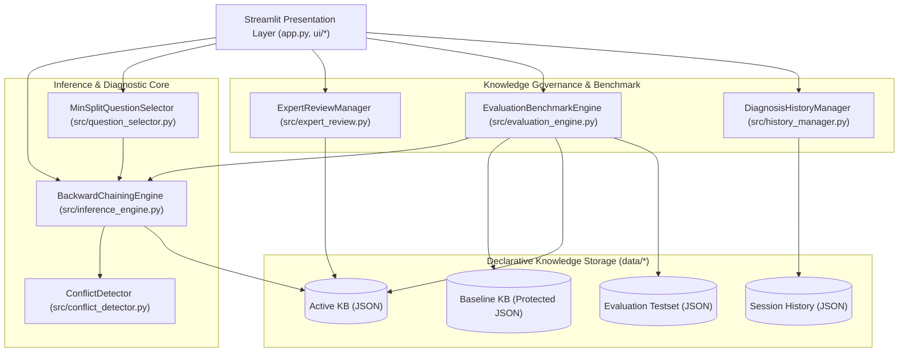
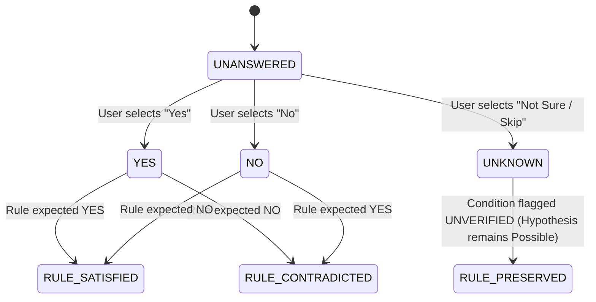
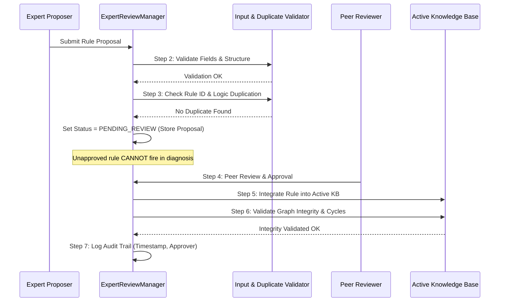

# System Architecture Specification

## AI-Based Intelligent Troubleshooting Expert System

This document provides a detailed architectural specification of the AI-Based Intelligent Troubleshooting Expert System, detailing module boundaries, data models, inference algorithms, cycle prevention, and empirical evaluation mechanics.

---

## 1. Architectural Overview & Layered Hierarchy

The system follows a strict layered separation of concerns to ensure testability, auditability, and clear boundaries between user presentation, reasoning logic, and storage.

---

## 2. Core Data Models (`src/models.py`)

### 2.1 Condition
Represents an individual antecedent required for a rule to fire.
- `fact: str` — Unique string identifier for the fact (e.g. `wifi_adapter_enabled`, `local_link_established`).
- `expected_value: str` — `"YES"` or `"NO"`.
- `description: str` — Human-readable prompt shown to the user.
- `is_intermediate: bool` — Flag indicating whether this fact is derived by other rules or observed directly.

### 2.2 Rule
Represents an inference rule in the knowledge base.
- `rule_id: str` — Unique identifier (e.g. `R-NET-001`, `R-NET-INT-001`).
- `domain: str` — One of the 4 supported domains.
- `conditions: List[Condition]` — Conjunction of required antecedent conditions.
- `diagnosis: Optional[str]` — Terminal diagnosis produced if conditions hold.
- `intermediate_fact: Optional[str]` — Intermediate fact produced if this is a derivation rule.
- `explanation: str` — Technical justification for why this conclusion follows.
- `solution: str` — Actionable, safety-checked remediation steps.
- `approval_status: str` — `"APPROVED"`, `"PENDING_REVIEW"`, or `"REJECTED"`.
- `author: str` & `created_at: str` — Audit trail metadata.

### 2.3 RuleEvaluation
Contains the dynamic evaluation state of a rule against the current fact base:
- `status: str` — One of:
  - `CONFIRMED`: All conditions are satisfied ($100\%$ verified).
  - `POSSIBLE`: Some conditions satisfied, remainder missing (none contradicted).
  - `RULED_OUT`: At least one condition contradicted by the user's answer.
- `evidence_coverage: float` — Ratio $\frac{\text{satisfied\_count}}{\text{total\_conditions}}$.
- `satisfied_conditions: List[Condition]`
- `missing_conditions: List[Condition]`
- `contradictions: List[ContradictionDetail]`
- `reasoning_trace: List[str]`

---

## 3. Multi-Level Backward Chaining Reasoning Engine

### 3.1 Recursive Goal Resolution
Backward chaining is goal-driven. Given a target goal $G$ in domain $D$:

1. **Check Cache:**
   - If $G \in \text{derived\_facts}$, return cached state.
   - If $G \in \text{user\_facts}$, return observed answer.

2. **Check Circular Dependency:**
   - Maintain a recursion set `call_stack`.
   - If $G \in \text{call\_stack}$:
     $$\text{Cycle Detected} \implies \text{Abort branch, log warning, return UNRESOLVED}$$

3. **Intermediate Fact Resolution:**
   - Find all rules where `r.intermediate_fact == G`.
   - For each candidate rule, recursively evaluate each condition $C_j$:
     - If $C_j$ is intermediate, call `evaluate_goal(C_j.fact, call_stack \cup {G})`.
     - If $C_j$ is atomic, lookup in `user_facts`.
   - If any rule is fully confirmed $\implies$ set `derived_facts[G] = "YES"`.
   - If all rules are ruled out $\implies$ set `derived_facts[G] = "NO"`.
   - Otherwise $\implies$ set `derived_facts[G] = "UNKNOWN"`.

4. **Diagnostic Rule Evaluation:**
   - Evaluates all terminal diagnostic rules for the domain.
   - Ranks active hypotheses by evidence coverage descending.
   - Categorizes session outcome into `CONFIRMED`, `POSSIBLE`, `INSUFFICIENT_EVIDENCE`, `CONFLICTING_EVIDENCE`, or `NO_MATCH`.

---

## 4. Intelligent Question Selection Heuristic

Arbitrary question ordering forces users to answer unnecessary questions. To optimize inquiry efficiency, our engine implements an information-gain-inspired **Min-Split Heuristic**:

### 4.1 Mathematical Formulation
Let $\mathcal{R}_{\text{active}}$ be the set of currently viable rules (status $\ne \text{RULED\_OUT}$).
For every unanswered atomic condition $C \notin \text{user\_facts}$:

$$\text{yes\_count}(C) = \left| \{ r \in \mathcal{R}_{\text{active}} \mid r \text{ requires } C = \text{YES} \} \right|$$
$$\text{no\_count}(C) = \left| \{ r \in \mathcal{R}_{\text{active}} \mid r \text{ requires } C = \text{NO} \} \right|$$

$$\text{Score}(C) = \min(\text{yes\_count}(C), \text{no\_count}(C))$$

### 4.2 Selection Criteria
1. **Primary Sort:** Maximize $\text{Score}(C)$.
   - A question with high score splits competing hypotheses into two non-empty subsets regardless of whether the user answers *Yes* or *No*.
2. **Secondary Sort (Tie-Breaker):** Maximize total rules impacted $\text{yes\_count}(C) + \text{no\_count}(C)$.
3. **Tertiary Sort (Deterministic Order):** Lexicographical ordering on fact name.

---

## 5. Uncertainty & Conflict Detection Mechanics

### 5.1 Tri-State Fact State Machine

### 5.2 Contradiction & Ruled-Out Tracking
Every eliminated rule generates a `ContradictionDetail` record containing:
- Target diagnosis and Rule ID
- Fact identifier and description
- Expected value ($E$)
- Actual user answer ($A$)
- Formal narrative: *"Hypothesis eliminated because condition required $E$, but observed answer was $A$."*

---

## 6. Knowledge-Base Learning & Governance Lifecycle

